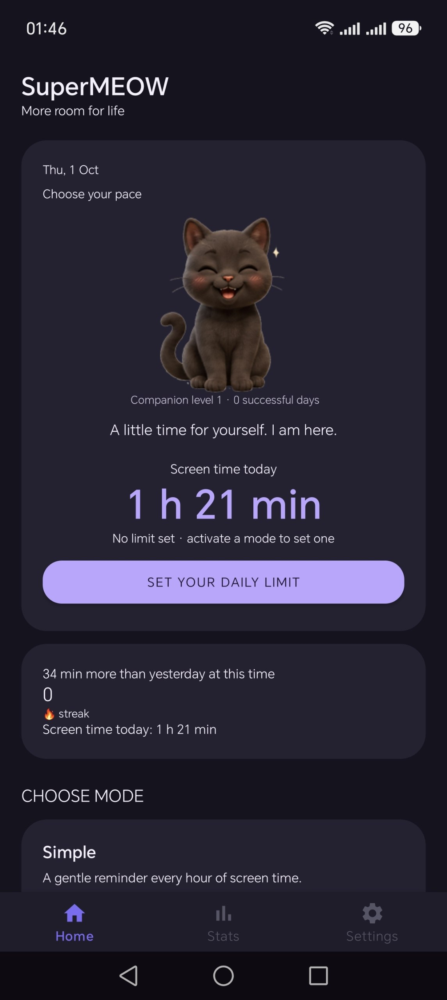
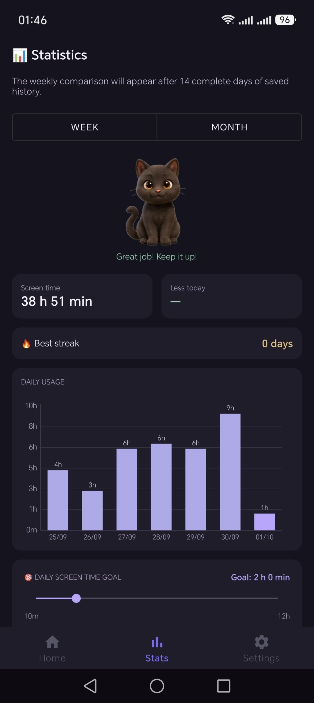
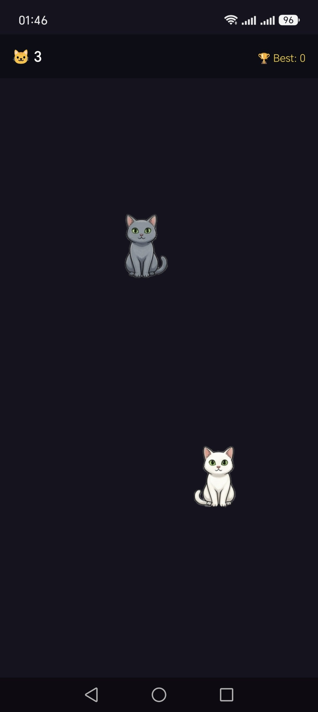

# SuperMEOW 🐱

**More room for life.** A free Android screen-time companion with cat reminders, daily limits, and usage statistics.

[Google Play](https://play.google.com/store/apps/details?id=com.supermeow) · [APK releases](https://github.com/cyberunagimaki/SuperMEOW/releases) · [Русское описание](README.ru.md)

Meet **Dayana**, your feline companion for a more mindful phone routine. SuperMEOW tracks screen time and brings cats onto your screen to remind you to take a break. Choose gentle hourly reminders or commit to a daily limit.

This repository contains the app description, screenshots, and downloadable builds. Source code is not included.

## Screenshots

  
  
  

Original screenshots supplied by the developer. Appearance may vary by device and build.

## Download

- **Everyday use:** install from [Google Play](https://play.google.com/store/apps/details?id=com.supermeow).
- **Preview APK:** open [Releases](https://github.com/cyberunagimaki/SuperMEOW/releases) and download `SuperMEOW-1.3.1-preview.apk`.
- Android **8.0 (API 26)** or later is required.

The GitHub APK is **1.3.1 Preview**, version code **14**, with package ID `com.supermeow.preview`. It is a debug-signed test build that installs separately from the Google Play app (`com.supermeow`). It does not replace or share the Play app's local data. Advertising and billing behavior may differ in a Preview build. A SHA-256 checksum accompanies the download.

To install the APK, open the downloaded file and, if Android asks, allow installation from the browser or file manager you used. You can revoke that permission afterward.

## Choose your mode

| Mode | How it works |
| --- | --- |
| **Simple** | A cat appears every hour of screen time to remind you to pause. You can turn this mode off whenever you like. |
| **Standard** | Set a total daily screen-time limit. Cats appear when you approach the limit; bows and rewarded ads can provide extra time. |
| **Hard** | Commit to your limit until midnight. The app asks for confirmation before activation; the mode cannot be disabled through the app until the day ends. Cats cover the screen when time runs out. |

Hard mode is a personal commitment feature, not a tamper-proof parental-control or device-management system. Android permissions and system settings still govern what the app can do.

## How screen-time tracking works

SuperMEOW reads Android usage events to estimate time spent in foreground apps. It excludes itself and selected system/launcher packages, accounts for overlapping activity sessions, and uses the device's local day boundary. Results may differ from the phone's built-in Digital Wellbeing totals because their counting rules can differ.

Your active mode and limit determine when reminders appear. A foreground monitoring service keeps the routine running, while an overlay service displays the cats. Permission changes or device background restrictions can affect tracking and reminders.

## Features

- **Daily goals and progress:** choose a goal and see today's usage against it.
- **Statistics:** daily usage charts with weekly and monthly views, streaks, and saved daily history. Comparisons require enough recorded history.
- **Cat companion progress:** successful days contribute to Dayana's level and unlock decorations at 3, 7, and 14 successful days.
- **Bows and extra time:** a bow can be redeemed for 15 extra minutes in a supported active limit mode. Rewarded ads offer bows or extra time depending on where the reward is claimed. Rewards require a completed, available ad.
- **Cat Catcher:** tap falling cats before they land, collect bonus points from golden cats, and track your best score. Three free plays are available per day; one bow restores three more plays.
- **Home-screen widget:** see today's screen time at a glance.
- **Language settings:** follow the device language or choose English, Russian, German, Spanish, Turkish, Arabic, Kazakh, Korean, Japanese, or Chinese.

## Getting started

1. Install SuperMEOW and follow the setup screens.
2. Grant Usage Access for tracking and display-over-other-apps permission for cats.
3. Enable notifications for screen-time and companion updates.
4. Optionally enable the Accessibility Service to help hide overlays promptly on calls, contacts, messages, and settings screens.
5. Choose a mode and, for Standard or Hard mode, set your daily limit.
6. Open Statistics to follow your progress, or Settings to change language and review permissions.

## Permissions and data

| Permission | Purpose |
| --- | --- |
| Usage Access | Read app-usage events for screen-time calculations. |
| Display over other apps | Show cat reminders above other apps. |
| Notifications | Display monitoring status and companion updates. |
| Accessibility Service (optional) | Detect relevant app/window changes so overlays can be hidden on designated essential screens. |

The app stores settings and screen-time records locally using Android preferences/DataStore and a Room database. It includes Google advertising and billing integrations; local storage does **not** mean the app has no network activity or third-party data processing. Consult the current Google Play listing, Data safety section, and linked privacy policy for published disclosures.

## Cost

SuperMEOW is free to download and use and contains ads, including optional rewarded ads. Any purchase availability and regional prices are shown in the app and Google Play.

## Help and feedback

Use this repository's [Issues](https://github.com/cyberunagimaki/SuperMEOW/issues) for reproducible problems and feature suggestions. Include your Android version, device model, app version, installation source (Play or Preview), and steps to reproduce. Remove personal information from screenshots and logs.

If cats or tracking stop working, review the permission status in Settings and the phone's background restrictions. If an ad is unavailable, try again later; a reward is not granted until the ad completes.

## Build notes

The distributed Preview APK was built successfully and the associated source passed 17 unit/Robolectric tests. These tests do not replace physical-device testing. Later source changes enabling R8 were **not** incorporated into this previously built APK; no optimized-release validation is claimed for it.

Developed by [cyberunagimaki](https://github.com/cyberunagimaki). This is a distribution and documentation repository, not an open-source release.
